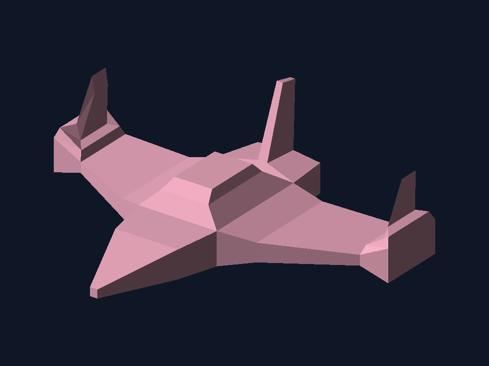

# Carga de modelos - Lab 4




La nave queda centrada en una ventana de 1000 × 750 píxeles. Tiene un color rosa pastel y una iluminación sencilla para que se distingan sus caras

## Cómo se dibuja

Primero se leen los vértices y las caras del OBJ. Cada cara guarda tres índices, así que el programa busca esos tres vértices, los pasa a coordenadas de pantalla y llama a `triangle()` para dibujarlos.

Este es el recorrido de las caras en `src/renderer.rs`:

```rust
for face in &model.faces {
    let index_a = face[0];
    let index_b = face[1];
    let index_c = face[2];

    let a = screen_vertices[index_a];
    let b = screen_vertices[index_b];
    let c = screen_vertices[index_c];

    // Se establece el color de la cara antes de dibujarla.
    triangle(buffer, a, b, c);
}
```

La nave tiene **84 vértices y 164 triángulos**. Para rellenarlos se usan coordenadas baricéntricas, y el z-buffer evita que las caras de atrás tapen las de adelante. Todo ese cálculo se hace en Rust; SDL2 se encarga de abrir la ventana y mostrar los píxeles.

## Cómo correrlo

En Windows se necesita Rust con la herramienta **MSVC x86_64** y las herramientas de compilación de Visual Studio, incluyendo el Windows SDK. SDL2 ya está incluido en `vendor/SDL2`.

Desde la carpeta del proyecto:

```powershell
cargo run --release --locked
```

También se puede compilar con el script:

```powershell
powershell -ExecutionPolicy Bypass -File .\build.ps1
```

Después se puede abrir `Ejecutar.cmd` o `bin/carga_modelos.exe`. La versión de entrega muestra solo la ventana de la nave.

- **Esc:** cerrar el programa.
- **S:** guardar otra vez la imagen en `docs/render.png`.

Para generar el PNG sin abrir la ventana:

```powershell
cargo run --release --locked -- --headless
```

## Archivos principales

| Archivo | Qué hace |
| --- | --- |
| `src/main.rs` | Abre la ventana y ejecuta el programa. |
| `src/obj_loader.rs` | Lee los vértices y los índices del OBJ. |
| `src/renderer.rs` | Transforma el modelo y recorre las caras. |
| `src/triangle.rs` | Rellena los triángulos píxel por píxel. |
| `src/framebuffer.rs` | Guarda los colores, la profundidad y el PNG. |
| `src/color.rs` | Define el rosa pastel de la nave y el fondo. |
| `assets/Nave_Espacial.obj` | Modelo del laboratorio anterior. |
| `docs/render.png` | Imagen del resultado que aparece en este README. |


